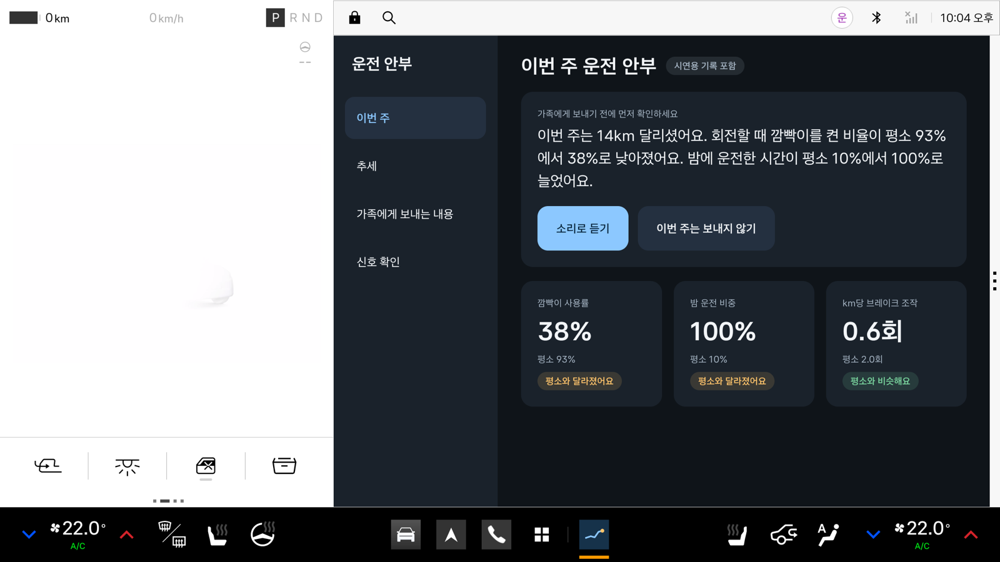
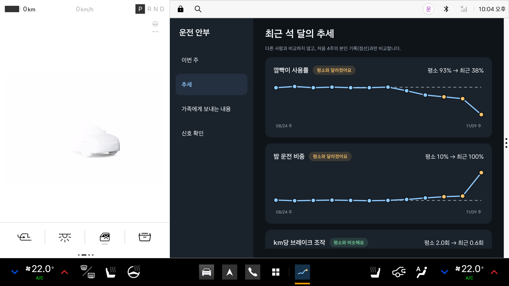
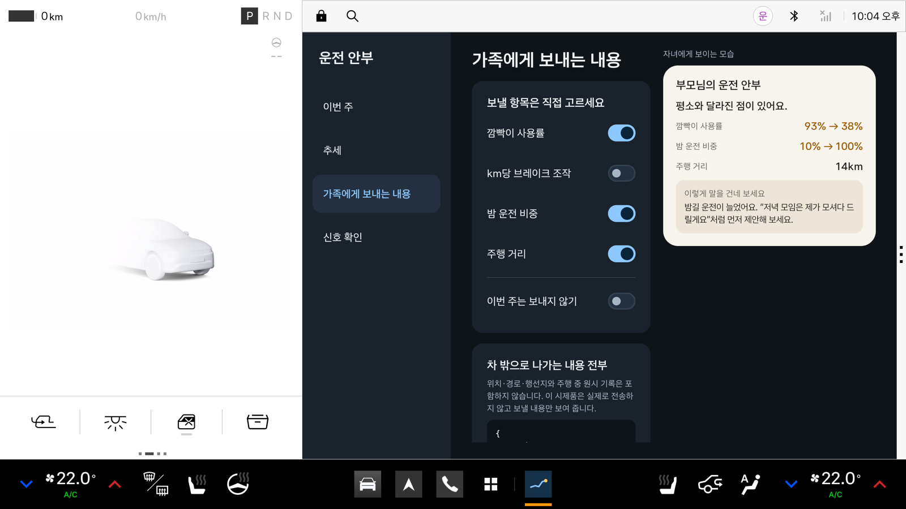
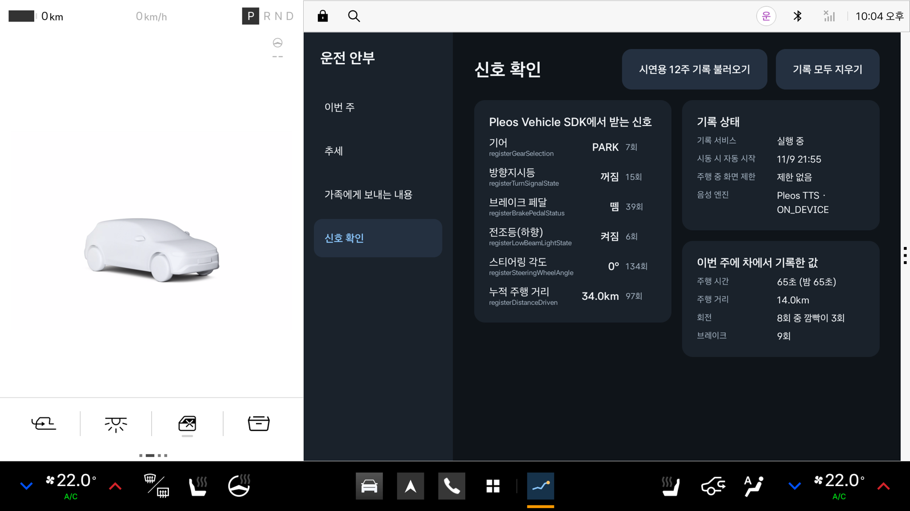

# 운전 안부 (Driving Check-in)

부모님 차의 깜빡이·브레이크·전조등 신호를 몇 달 치 추세로 모아, 부모님이 먼저 확인한 뒤 자녀와 나누는 고령 운전 안부 앱입니다.

현대자동차그룹 차량용 앱 개발 공모전 제출용 시제품(Pleos Connect 차량 앱)입니다. 팀명은 **운전 안부**입니다.

- **APK(release):** [`apk/운전안부_운전안부_release.apk`](apk/운전안부_운전안부_release.apk)
- **시연 영상(에뮬레이터 녹화, 2분 9초, 무음):** [`docs/demo.mp4`](docs/demo.mp4)

| 이번 주 | 추세 |
|---|---|
|  |  |
| **가족에게 보내는 내용** | **신호 확인** |
|  |  |

## 시제품이 하는 일

- **차량 신호 기록:** Pleos Vehicle SDK의 리스너 콜백으로 기어, 방향지시등, 브레이크 페달, 전조등, 스티어링 각도, 누적 주행 거리를 받습니다. 폴링하지 않고 값이 바뀔 때만 처리합니다.
- **주간 지표 집계:** 회전할 때 깜빡이를 켠 비율, km당 브레이크 조작 횟수, 밤 운전 비중, 주행 거리를 주 단위로 차 안에 저장합니다. 위치와 경로는 받지도 저장하지도 않습니다.
- **본인 기준선과 비교:** 처음 4주의 평균을 그 운전자의 기준선으로 삼고, 최근 3주가 연속으로 15% 이상 벗어났을 때만 "평소와 달라졌어요"로 표시합니다.
- **본인이 먼저 확인:** 주차 상태에서 요약을 화면으로 보고 Pleos TextToSpeech로 듣습니다. 보낼 항목을 직접 고르고 이번 주 공유를 보류할 수 있습니다.
- **주행 중 무방해:** 주행 중에는 화면과 음성을 내지 않습니다. 기록은 화면 없이 계속됩니다.

## 사용한 Pleos Connect SDK

| 기능 | SDK / API |
|---|---|
| 주행·주차 구분 | Vehicle `Gear.registerGearSelection` |
| 깜빡이 사용률 | Vehicle `TurnSignal.registerTurnSignalState`, `SteeringWheel.registerSteeringWheelAngle` |
| 브레이크 조작 | Vehicle `Brake.registerBrakePedalStatus` |
| 밤 운전 비중 | Vehicle `Light.registerLowBeamLightState` |
| 주행 거리 | Vehicle `Odometer.registerDistanceDriven` |
| 요약 음성 안내 | TextToSpeech `Mode.ON_DEVICE`, `ko-KR` |
| 주행 중 화면 제한 확인 | Android `CarUxRestrictionsManager` |

선언한 차량 권한은 읽기 권한인 `pleos.car.permission.CAR_LIGHTS`, `CAR_DRIVE`와 `TTS_SERVICE`입니다. 차량 제어 권한(`CONTROL_CAR_*`)은 쓰지 않습니다. `INTERNET` 권한은 TextToSpeech SDK가 선언한 것이 병합된 것이며, 앱 코드는 네트워크로 아무것도 보내지 않습니다.

## 테스트 환경

| 항목 | 값 |
|---|---|
| 에뮬레이터 | Pleos Connect Emulator v2.1.0 (Android 14, API 34, arm64) |
| 화면 규격 | 2560×1440, 160dpi(가로형 중앙 디스플레이). 앱 창은 가로 1120dp 기준으로 설계하고 화면 폭에 맞춰 키웁니다 |
| Vehicle SDK | `ai.pleos.playground:Vehicle:2.3.2` |
| TextToSpeech SDK | `ai.pleos.playground:TextToSpeech:3.3.1` |
| 빌드 | Android Gradle Plugin 8.9.1, Gradle 8.13, Kotlin 2.0.21, JDK 17 이상 |
| 앱 | minSdk 28, targetSdk 34, 패키지 `com.drivingcheckin.car` |

Pleos 개발자 계정이나 앱 키 없이 동작합니다. SDK는 공개 Maven 저장소(`https://nexus-playground.pleos.ai/repository/maven-releases/`)에서 받습니다.

## 실행 방법

### 1. 에뮬레이터 준비

Pleos 공식 문서의 안내대로 Android Studio의 SDK Manager에 Pleos Connect 시스템 이미지 업데이트 사이트를 추가해 설치하고, Automotive 폼 팩터의 `Pleos Connect v2.1.0` 가상 기기를 만들어 실행합니다.

### 2. 앱 설치

```sh
adb install -r apk/운전안부_운전안부_release.apk
```

에뮬레이터의 앱 목록에서 "운전 안부"를 엽니다. 처음 열면 알림 허용을 묻습니다. 기록 서비스가 상태 표시줄에 띄우는 알림이며, 허용하지 않아도 기록은 됩니다.

소스에서 빌드하려면 `./gradlew assembleRelease`를 실행합니다. 결과물은 `app/build/outputs/apk/release/app-release.apk`이고, 별도 서명 키 없이 바로 설치할 수 있도록 Android 기본 debug 키로 서명합니다. 이미 설치된 앱과 서명 키가 다르다는 오류가 나면 `adb uninstall com.drivingcheckin.car` 후 다시 설치합니다.

### 3. 차량 신호 넣기

```sh
adb forward tcp:8088 tcp:8088
```

PC 브라우저에서 `http://127.0.0.1:8088/`(Pleos Virtual Console)을 열고 다음 순서로 조작합니다. 콘솔은 이 브라우저 페이지가 열려 있는 동안에만 차량 신호를 바꿉니다.

1. 기어를 **D**로 바꿉니다. 시스템이 앱 화면을 "주행 중에는 사용할 수 없습니다"로 가립니다.
2. Turn Signal State를 Blink left(또는 right)로 켜고, Steering을 90도 이상 돌렸다가 0으로 되돌립니다(깜빡이를 켠 회전 1회).
3. Turn Signal State를 Off로 두고 Steering을 다시 돌립니다(깜빡이를 켜지 않은 회전 1회).
4. BRAKE 페달을 밟았다 떼고, Exterior Lights Mode를 Low beam으로 바꾸고, Odometer 값을 올립니다. 계기 오류를 거르기 위해 한 번에 50km 넘게 바뀐 값은 주행 거리에 넣지 않으므로, Odometer는 조금씩 올립니다.
5. 기어를 **P**로 바꿉니다. 앱의 "신호 확인" 탭에 이번 주 기록이 표시됩니다.

회전 5회, 주행 1km, 주행 60초 미만인 주는 표본이 적어 해당 지표를 비워 둡니다.

### 4. 추세 화면 보기

"신호 확인" 탭의 **시연용 12주 기록 불러오기**를 누르면 최근 4주에 깜빡이 사용률이 낮아지고 밤 운전이 늘어나는 시나리오가 들어갑니다. 시연용 기록이 들어 있으면 "이번 주" 화면에 "시연용 기록 포함" 표시가 붙습니다. 이번 주 값은 에뮬레이터에서 직접 기록한 값이 그대로 쓰입니다.

## 에뮬레이터에서 확인한 것

아래는 저장소의 release APK를 새로 설치한 Pleos Connect Emulator v2.1.0에서 2026-11-13에 확인한 결과입니다.

| 확인 항목 | 결과 |
|---|---|
| 차량 신호 6종 수신 | 모두 오류 없이 수신 |
| 주행(D) 중 기록 | 회전 2회(깜빡이 1회), 브레이크 1회, 전조등 켠 시간이 조작한 대로 집계됨 |
| 재부팅 후 앱을 열지 않은 상태의 자동 시작 | 기록 서비스가 시작되고 이후 주행이 기록됨 |
| Pleos TextToSpeech | `ON_DEVICE` 초기화 성공, 요약 문장의 재생 시작·완료 콜백 수신 |
| 시연용 12주 기록 | "이번 주" 화면에 깜빡이 사용률·밤 운전 비중의 "평소와 달라졌어요" 표시와 요약 문장이 나옴 |
| 단위 테스트 | 11개 통과(`./gradlew testDebugUnitTest`) |

## 시제품의 한계

- **자녀 앱과 서버는 없습니다.** "가족에게 보내는 내용" 화면은 보낼 내용과 자녀 카드의 모습을 차 안에서 미리 보여 줄 뿐, 실제로 전송하지 않습니다.
- **회전 판단은 스티어링 각도만 씁니다.** 기획서의 내비게이션 안내 지점 연동, 재탐색 지표, 차량 관리 알림, 음성 응답은 구현하지 않았습니다.
- **실차에서는 확인하지 않았습니다.** 위 결과는 모두 에뮬레이터 기준이며, 실제 차량의 시동 전원 정책과 신호 주기에서는 달라질 수 있습니다.
- **음성이 실제로 들리는지는 확인하지 않았습니다.** 오디오 없이 실행한 에뮬레이터에서 재생 시작 콜백까지만 확인했고, 시연 영상에도 소리가 없습니다.
- **변화 판단 기준(15%, 3주 연속)은 임시 값입니다.** 시범 운영 자료로 보정해야 합니다.

## 코드 구조

```
app/src/main/java/com/drivingcheckin/car/
  vehicle/Recorder.kt        Pleos Vehicle SDK 리스너 등록, 주간 기록 저장
  vehicle/TripAggregator.kt  신호 변화를 지표 증가분으로 바꾸는 순수 로직
  vehicle/Speaker.kt         Pleos TextToSpeech 재생
  data/Insight.kt            기준선 비교, 요약 문장, 대화 가이드
  data/WeekStore.kt          주간 기록·공유 설정 저장, 시연용 기록
  RecorderService.kt         화면 없이 리스너를 유지하는 서비스
  BootReceiver.kt            시동 후 자동 시작
  ui/                        화면(Jetpack Compose)
```
